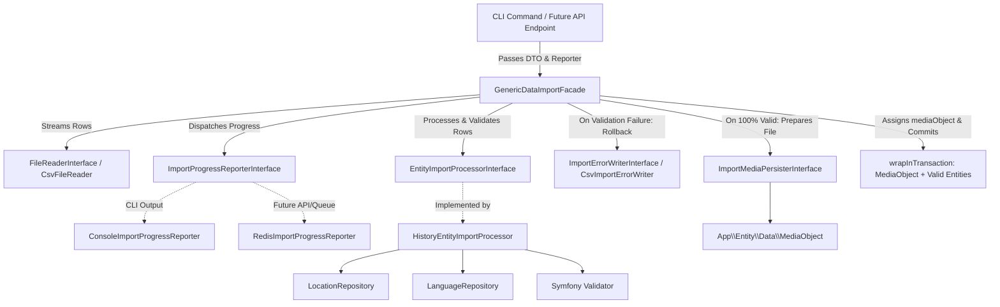

# Data Import Framework & Domain Processors

## Architectural Role

The Data Import Framework in MEDGREENREV provides a decoupled, extensible, and transactional bulk data ingestion engine. Designed using the **Facade**, **Strategy**, and **Processor** design patterns, the framework cleanly separates file parsing, row iteration, reference resolution, constraint validation, error reporting, progress tracking, and file archival.

While initially hosting the historical data pipeline (`HistoryEntityImportProcessor`), the core engine (`GenericDataImportFacade`) is entirely domain-agnostic. New domain imports (e.g., Archaeology, Absolute Dating, Radiocarbon, Specialist Analyses) can be plugged in simply by implementing a single processor contract (`EntityImportProcessorInterface`) without modifying the underlying import engine, transaction lifecycle, or media archival pipeline.

---

## Architecture Diagram

---

## Core Framework Components

The generalized framework resides in [api/src/Service/Import/](../../../api/src/Service/Import/) and [api/src/Dto/](../../../api/src/Dto/):

### 1. Data Transfer Objects (DTOs)
* **`ImportInputDtoInterface` / `GenericImportInputDto`:** [api/src/Dto/Input/GenericImportInputDto.php](../../../api/src/Dto/Input/GenericImportInputDto.php)
  * Encapsulates the import parameters: `$filePath`, domain `$type` string, uploading `$user` (`App\Entity\Auth\User`), and optional `$context` array.
* **`ImportResultDto`:** [api/src/Dto/Output/ImportResultDto.php](../../../api/src/Dto/Output/ImportResultDto.php)
  * Returns the operation outcome: `bool $success`, `int $totalRows`, `int $importedCount`, `array $validationErrors`, `?string $errorFilePath`, `?MediaObject $mediaObject`, and `?string $error`.
  * The `$error` property provides a standardized, human-readable error description for all failure modes, including early aborts before row processing (e.g., non-existent files, permission restrictions, format mismatches, unsupported entity types, missing headers, empty files, and runtime exceptions) as well as row validation failures.

### 2. Streaming File Readers (`FileReaderInterface`)
* **Contract:** [api/src/Service/Import/Reader/FileReaderInterface.php](../../../api/src/Service/Import/Reader/FileReaderInterface.php)
  * `supports(string $filePath): bool`
  * `getHeaders(string $filePath): array`
  * `countRows(string $filePath): int`
  * `read(string $filePath): \Generator<int, array<string, mixed>>`
* **`CsvFileReader`:** [api/src/Service/Import/Reader/CsvFileReader.php](../../../api/src/Service/Import/Reader/CsvFileReader.php)
  * Automatically detects delimiters (comma vs. semicolon).
  * Strips UTF-8 Byte Order Marks (BOM).
  * Trims and normalizes header keys.
  * Streams rows one at a time using PHP `\Generator` (`fgetcsv` with explicit escape parameter) to maintain a minimal memory footprint on large datasets.

### 3. Pluggable Domain Processors (`EntityImportProcessorInterface`)
* **Contract:** [api/src/Service/Import/Processor/EntityImportProcessorInterface.php](../../../api/src/Service/Import/Processor/EntityImportProcessorInterface.php)
  * `supports(string $type): bool`: Determines which data types the processor handles.
  * `getEntityLabel(string $type): string`: Human-readable label (e.g., `'Animal'`, `'Plant'`) used in generated `MediaObject` descriptions.
  * `getRequiredHeaders(string $type): array`: Validates the presence of mandatory columns before row parsing starts.
  * `processRow(int $rowNumber, array $rowData, ImportInputDtoInterface $input): RowProcessResult`: Maps row fields, resolves foreign references, and validates constraints.
* **`RowProcessResult`:** [api/src/Service/Import/Processor/RowProcessResult.php](../../../api/src/Service/Import/Processor/RowProcessResult.php)
  * Encapsulates either a successfully mapped entity ready for persistence (`?object $entity`) or a list of validation error messages (`list<string> $errors`).

### 4. Error File Writer (`ImportErrorWriterInterface`)
* **Contract:** [api/src/Service/Import/Writer/ImportErrorWriterInterface.php](../../../api/src/Service/Import/Writer/ImportErrorWriterInterface.php)
* **`CsvImportErrorWriter`:** [api/src/Service/Import/Writer/CsvImportErrorWriter.php](../../../api/src/Service/Import/Writer/CsvImportErrorWriter.php)
  * Generates error files under `var/imports/errors/<timestamp>_<basename>_errors.csv`.
  * Preserves all original source columns exactly as provided and appends an `error` column containing semicolon-delimited validation messages.

### 5. MediaObject Archival & Linking (`ImportMediaPersisterInterface`)
* **Contract:** [api/src/Service/Import/Media/ImportMediaPersisterInterface.php](../../../api/src/Service/Import/Media/ImportMediaPersisterInterface.php)
* **`ImportMediaPersister`:** [api/src/Service/Import/Media/ImportMediaPersister.php](../../../api/src/Service/Import/Media/ImportMediaPersister.php)
  * Prepares `MediaObject` instances with `createMediaObject` to be persisted and flushed within the main entity transaction.
  * Resolves vocabulary type `@voc__media_object__data_raw` (group `data`, value `raw data`).
  * Assigns standardized description: `Raw data imported <Entity>` (e.g., `Raw data imported Animal`, `Raw data imported Plant`).
  * Computes SHA256 checksum and binds `$uploadedBy` to the importing `User`.
  * Provides `cleanup(?MediaObject $mediaObject, ?string $tempFilePath)` to remove temporary files and orphaned destination files if the database transaction aborts.

### 6. Decoupled Progress Reporting (`ImportProgressReporterInterface`)
* **Contract:** [api/src/Service/Import/Progress/ImportProgressReporterInterface.php](../../../api/src/Service/Import/Progress/ImportProgressReporterInterface.php)
  * `onStart(int $totalRows): void`
  * `onRowProcessed(int $currentRow, int $totalRows, bool $isValid): void`
  * `onFinish(ImportResultDto $result): void`
* **Implementations:**
  * `NullImportProgressReporter`: Default no-op reporter for unit tests and headless environments.
  * `ConsoleImportProgressReporter`: Wraps Symfony Console `ProgressBar` for live CLI feedback.

### 7. Orchestration Engine (`GenericDataImportFacade`)
* **Implementation:** [api/src/Service/Import/GenericDataImportFacade.php](../../../api/src/Service/Import/GenericDataImportFacade.php)
* **Execution Flow:**
  1. **Pre-Flight Validation:**
     * Verifies file existence and read permissions on disk (returns failure with `$error` if missing or unreadable).
     * Identifies the supporting `FileReaderInterface` (returns failure with `$error` if format is unsupported).
     * Identifies the supporting `EntityImportProcessorInterface` (returns failure with `$error` if entity domain type is unrecognized).
  2. **Header & Data Pre-Checks:**
     * Extracts headers and validates presence of all mandatory columns required by the processor.
     * Counts data rows; aborts with clear `$error` if the file has 0 data rows.
     * Notifies the progress reporter via `onStart`.
  3. **Exhaustive Row Iteration:** Processes every row from start to finish without early termination, accumulating valid mapped entities and collecting all row failures.
  4. **Transactional Evaluation:**
     * **If validation errors exist:** Aborts database persistence (0 database rows inserted), generates the timestamped error CSV in `var/imports/errors/`, and returns a failure `ImportResultDto` populated with `$error`, `$validationErrors`, and `$errorFilePath`.
     * **If 100% valid:** Prepares the `MediaObject` via `createMediaObject`, assigns it to each valid entity (`setMediaObject`), and persists and flushes all entities and the `MediaObject` atomically within `wrapInTransaction`. In case of transaction failure, `cleanup` removes any temporary or orphaned disk files.
     * **On unexpected runtime exception:** Catches any throwable during execution and returns a failure `ImportResultDto` reporting the exact exception message in `$error`.

---

## Historical Domain Implementation

The historical domain pipeline is located in [api/src/Service/History/Import/](../../../api/src/Service/History/Import/):

### 1. `HistoryEntityImportProcessor`
* **Path:** [api/src/Service/History/Import/HistoryEntityImportProcessor.php](../../../api/src/Service/History/Import/HistoryEntityImportProcessor.php)
* **Supported Types:** `animal`, `plant`
* **Required Headers:** `location`, `language`, `animal` or `plant`, `english_name`, `chronology_lower`, `chronology_upper`, `reference`
* **Reference Resolution with In-Memory Caching:**
  * **Location:** Resolved by value against `App\Entity\Vocabulary\History\Location` via `LocationRepository`.
  * **Language:** Resolved by value against `App\Entity\Vocabulary\History\Language` via `LanguageRepository`.
  * Known locations and languages are cached in memory during execution to eliminate redundant database queries across large datasets.
* **Validation Groups:** Validates mapped entities using Symfony `ValidatorInterface` under entity create groups:
  * `Animal`: `['validation:history_animal:create']`
  * `Plant`: `['validation:history_plant:create']`

### 2. `HistoryImportFacade`
* **Path:** [api/src/Service/History/Import/HistoryImportFacade.php](../../../api/src/Service/History/Import/HistoryImportFacade.php)
* Specialised domain entry point implementing `HistoryImportFacadeInterface`, wrapping `GenericDataImportFacade`.

---

## System Invariants & Policies

1. **Atomic Transaction Boundary:** Either 100% of rows are persisted and the file is archived as a `MediaObject`, or 0 rows enter the database and an error CSV is generated.
2. **Exhaustive Error Collection:** Importers must never stop at the first failing row. All rows across the entire file are evaluated to provide complete feedback in the error CSV.
3. **Auditability & Provenance:** Every successfully imported file is linked to a `MediaObject` record containing the creator's user ID, upload timestamp, SHA256 hash, and raw data vocabulary classification.
4. **Transport Agnosticism:** The core service layer has zero coupling to Symfony Console or HTTP requests, making it directly consumable by CLI commands, Symfony Messenger background workers, or API Platform controllers.

---

## Key Relationships

* **Generic Import Services:** [api/src/Service/Import/](../../../api/src/Service/Import/)
* **Historical Import Services:** [api/src/Service/History/Import/](../../../api/src/Service/History/Import/)
* **Console Command:** [api/src/Command/HistoryImportCommand.php](../../../api/src/Command/HistoryImportCommand.php)
* **Bulk Ingestion Workflow:** [Data Import & Bulk Ingestion Workflow](../workflows/data_import.md)
* **Historical Domain Entities:** [Historical Written Sources & Biodiversity Entities](./entities/history.md)

---

## Related Nodes

* Back to [Backend Hub](./index.md)
* Back to [Main Knowledge Graph Index](../index.md)
