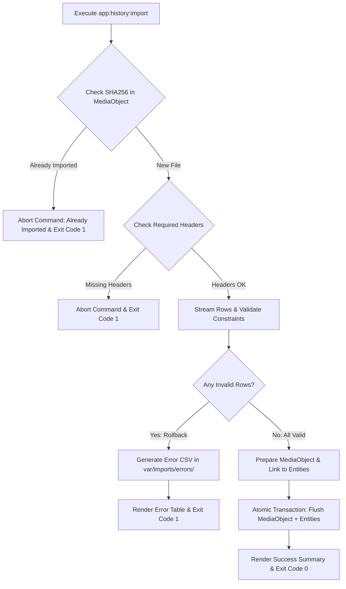

# Data Import & Bulk Ingestion Workflow

## Architectural Role

Bulk data ingestion in MEDGREENREV allows administrators to import structured tabular datasets provided by researchers into the database with atomic transaction safety, rigorous entity constraint validation, and automated media file provenance tracking.

The CLI command `app:history:import` provides an interactive and non-interactive interface for historical animal and plant data files, powered by the underlying [Data Import Framework](../backend/data_import_framework.md).

---

## Command Interface & Synopsis

```bash
docker compose exec php bin/console app:history:import <file> [options]
```

### 1. Arguments & Options
* **`file` (required):** Absolute or relative path to the input data file (e.g. `var/data/historical_animals.csv`).
* **`--type` / `-t` (optional):** Domain data type to import (`animal` or `plant`). If omitted in interactive mode, the command prompts for a selection.
* **`--user` / `-u` (optional):** User identifier (email address or UUID) to assign as `createdBy` on imported records and `uploadedBy` on the archived `MediaObject`. If omitted in interactive mode, the command prompts for user selection.

---

## Input File Specification (CSV)

### 1. Required Headers & Field Definitions

| Column Header | Format / Type | Description / Resolution Rule |
| :--- | :--- | :--- |
| `location` | String | Vocabulary value resolved against `App\Entity\Vocabulary\History\Location`. Unknown locations trigger a validation error. |
| `language` | String | Vocabulary value resolved against `App\Entity\Vocabulary\History\Language` (e.g. `latin`, `castilian`, `catalan`, `arabic`). Unknown languages trigger a validation error. |
| `animal` / `plant` | String | The exact historical term as written in the source manuscript (e.g. Latin, Arabic, archaic Spanish/Catalan, such as `caballo`, `oveja`, `trigo`, `olivo`). Stored verbatim. |
| `english_name` | String | Mandatory English reference name (e.g. `horse`, `sheep`, `wheat`, `olive`) used for 1:1 join matching against Botany / Zoo taxonomy tables (`Vocabulary\Botany\Taxonomy` and `Vocabulary\Zoo\Taxonomy`). For consistency, prefer the fruit/crop name over the tree/cultivation term where possible (e.g. `grapevine` not `vineyard`, `fig` not `fig tree`). |
| `chronology_lower` | Integer | Lower chronological year bound (e.g. `1100`). |
| `chronology_upper` | Integer | Upper chronological year bound (e.g. `1250`). Must be $\ge$ `chronology_lower`. |
| `reference` | String | Historical source reference citation or manuscript folio. |
| `notes` | String (optional) | Supplementary research annotations or commentary. |

### 2. Format Requirements
* **Encoding:** UTF-8 (BOM headers are automatically stripped).
* **Delimiters:** Auto-detected (supports comma `,` and semicolon `;`).
* **Header Normalization:** Column names are trimmed and matched case-insensitively.
* **Taxonomy Name Resolution:** Mentions of animals and plants are decoupled: `animal`/`plant` preserves the source term, while `english_name` provides the taxonomy reference matched against taxonomy tables (see [Historical Taxonomy Name Resolution](../backend/history_taxonomy_name_resolution.md)).

---

## Execution Lifecycle



### 1. Interactive Execution Example
When executed without options, the command interactively guides the user:

```bash
docker compose exec php bin/console app:history:import var/data/animals.csv
```
1. Prompts for dataset type (`animal` / `plant`).
2. Prompts for uploading user.
3. Renders a live console progress bar as rows are evaluated.

### 2. Non-Interactive / Scripted Example
For automated pipelines or CI data loading:

```bash
docker compose exec php bin/console app:history:import var/data/plants.csv \
  --type=plant \
  --user=editor@example.com \
  --no-interaction
```

---

## Outcome Scenarios & Error Resolution

### 1. Success Scenario (100% Valid Rows)
* **Database State:** All parsed domain entities and the source `MediaObject` are committed atomically within a single database transaction.
* **MediaObject Archival & Provenance Linking:** The imported file is registered as a `MediaObject` with:
  * Vocabulary Type: `raw data` (`@voc__media_object__data_raw`).
  * Description: `Raw data imported: written source animal citations` or `Raw data imported: written source plant citations`.
  * Checksum: Calculated SHA256.
  * Uploaded By: The specified `User`.
  * Entity References: Every imported row record links to the `MediaObject` via `media_object_id`.
* **Exit Code:** `0` (Success).

### 2. Duplicate File Scenario (Already Imported)
* **Pre-Flight Hash Check:** The importer computes the SHA256 checksum of the file before any parsing or database operations and matches it against `data.media_objects`.
* **Database State:** 0 operations executed (zero database writes).
* **Console Output:** Renders an error indicating that the file has already been imported with its SHA256 checksum.
* **Exit Code:** `1` (Failure).

### 3. Failure Scenario (Validation or Reference Errors)
* **Exhaustive Evaluation:** The command processes all rows through to the end of the file, collecting all validation errors rather than aborting at the first failure.
* **Database State:** Full transaction rollback (0 database rows inserted).
* **Error CSV Generation:** An error CSV file is written to `var/imports/errors/<timestamp>_<basename>_errors.csv`.
  * Retains all original columns and row values.
  * Adds an `error` column containing specific constraint violation messages (e.g. `Location "UnknownLoc" does not exist; chronologyLower cannot be greater than chronologyUpper`).
* **Console Output:** Displays a summary table of failed rows and outputs the path to the error file for researcher review.
* **Exit Code:** `1` (Failure).

---

## Verification & Operational Testing

### 1. Manual Verification
* Inspect imported entities via API or PostgreSQL:
  ```bash
  docker compose exec database psql -U app -d app -c "SELECT id, animal, chronology_lower, chronology_upper FROM data.history_animals ORDER BY created_at DESC LIMIT 5;"
  ```
* Verify `MediaObject` registration:
  ```bash
  docker compose exec database psql -U app -d app -c "SELECT id, description, sha256, upload_date FROM data.media_objects ORDER BY upload_date DESC LIMIT 1;"
  ```

### 2. Automated Test Suite Execution
Execute the dedicated functional and unit test suites:

```bash
# Functional command tests
docker compose exec php bin/phpunit tests/Functional/Command/HistoryImportCommandTest.php

# Generic import and history processor unit tests
docker compose exec php bin/phpunit tests/Unit/Service/Import/ tests/Unit/Service/History/Import/
```

---

## Key Relationships

* **Command Source:** [api/src/Command/HistoryImportCommand.php](../../../api/src/Command/HistoryImportCommand.php)
* **Data Import Framework:** [Data Import Framework & Domain Processors](../backend/data_import_framework.md)
* **Historical Domain Entities:** [Historical Written Sources & Biodiversity Entities](../backend/entities/history.md)
* **Historical Taxonomy Resolution:** [Historical Taxonomy Name Resolution (Spanish/English)](../backend/history_taxonomy_name_resolution.md)
* **MediaObject Entity:** [api/src/Entity/Data/MediaObject.php](../../../api/src/Entity/Data/MediaObject.php)

---

## Related Nodes

* Back to [Workflows Hub](./index.md)
* Back to [Main Knowledge Graph Index](../index.md)
