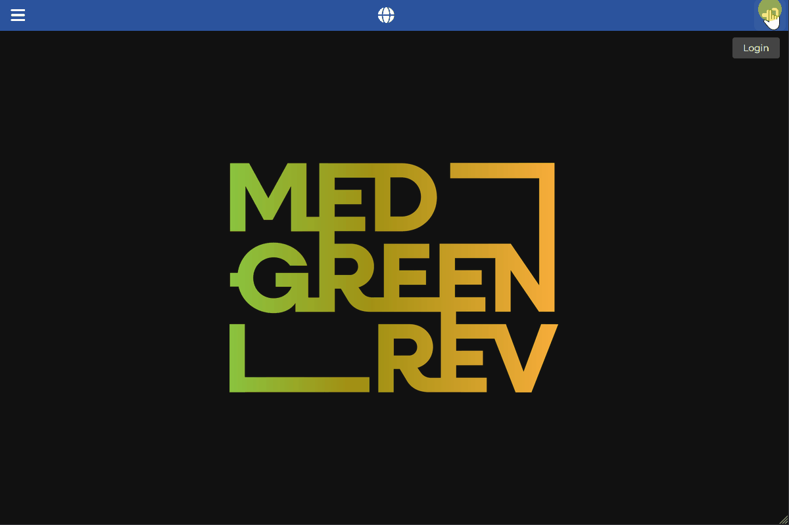

[Back to User Documentation](index.md)
# Core Sampling Management
This document describes how core sampling data is managed within the MEDGREENREV system. Data is organized in a hierarchy with three categories:

- **Sampling Site** (root of the hierarchy)
- **Sediment Core** (belongs to a sampling site)
- **Stratigraphic Unit** (belongs to a sampling site)
- **Sampling Core Depth** (association of a sediment core and a stratigraphic unit of the same sampling site)

## Table of Contents
- [Sampling Site](#sampling-site)
  - [Permissions](#permissions)
  - [Procedure](#procedure)
  - [Visual Guide](#visual-guide)
- [Sediment Core](#sediment-core)
  - [Permissions](#permissions-1)
  - [Procedure](#procedure-1)
  - [Visual Guide](#visual-guide-1)
- [Stratigraphic Unit](#stratigraphic-unit)
  - [Permissions](#permissions-2)
  - [Procedure](#procedure-2)
  - [Visual Guide](#visual-guide-2)
- [Sampling Core Depth](#sampling-core-depth)
  - [Permissions](#permissions-3)
  - [Procedure](#procedure-3)
  - [Visual Guide](#visual-guide-3)

## Sampling Site
The sampling site is the root of the core sampling hierarchy: it must be created before any sediment core or stratigraphic unit can be added.
### Permissions
As an authenticated user with the geoarchaeologist role (editor), you can create a new sampling site. See the [Authorization](authorization.md) document for more information.
### Procedure
1. Navigate to the **Data / Sampling / Sites** section using the left-hand navigation menu.
2. Click the vertical **...** button in the top bar and select the **add new** option in the dropdown menu.
3. Fill in the form, keeping in mind the required fields and any validation rules.
4. Click the **Submit** button.
### Visual Guide
The following GIF demonstrates the process:

## Sediment Core
### Permissions
As an authenticated user with the geoarchaeologist role, you can create a new sediment core. See the [Authorization](authorization.md) document for more information.
### Procedure
1. Navigate to the **Data / Sampling / Sites** section using the left-hand navigation menu.
2. Find the relevant sampling site and click the right arrow button (**View Item**) to open its details page.
3. Choose the **Sediment Core** tab.
4. Click the vertical **...** button in the top bar and select the **add new** option in the dropdown menu.
5. Fill in the form with the relevant data, keeping in mind the required fields and any validation rules.
6. Click the **Submit** button.
### Visual Guide
The following GIF demonstrates the process:

## Stratigraphic Unit
### Permissions
As an authenticated user with the geoarchaeologist role, you can create a new stratigraphic unit. See the [Authorization](authorization.md) document for more information.
### Procedure
1. Navigate to the **Data / Sampling / Sites** section using the left-hand navigation menu.
2. Find the relevant sampling site and click the right arrow button (**View Item**) to open its details page.
3. Choose the **Stratigraphic Unit** tab.
4. Click the vertical **...** button in the top bar and select the **add new** option in the dropdown menu.
5. Fill in the form with the relevant data, keeping in mind the required fields and any validation rules.
6. Click the **Submit** button.
### Visual Guide
The following GIF demonstrates the process:

## Sampling Core Depth
A sampling core depth is the association of a sediment core and a stratigraphic unit belonging to the same sampling site. It can be created from either the sediment core or the stratigraphic unit detail page.
### Permissions
As an authenticated user with the geoarchaeologist role (editor), you can create a new sampling core depth. See the [Authorization](authorization.md) document for more information.
### Procedure
1. Navigate to the **Data / Sampling / Sites** section using the left-hand navigation menu.
2. Find the relevant sampling site and click the right arrow button (**View Item**) to open its details page.
3. Choose the **Sediment Core** or **Stratigraphic Unit** tab and open the detail page of the relevant item (the core or the stratigraphic unit).
4. Choose the **Depth** tab.
5. Click the vertical **...** button in the top bar and select the **add new** option in the dropdown menu.
6. Fill in the form, selecting the associated sediment core or stratigraphic unit (it must belong to the same sampling site) and keeping in mind the required fields and any validation rules.
7. Click the **Submit** button.
### Visual Guide
The following GIF demonstrates the process:

